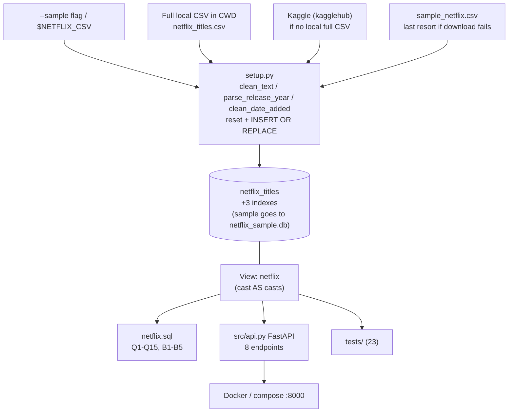

# Comprehensive Technical Review: Netflix Data Analysis Using SQL

> **Role & Perspective:** Senior AI / Data Engineer Review  
> **Purpose:** Study guide for interview preparation  
> **Repository Assessed:** `NETFLIX-DATA-ANALYSIS-USING-SQL` (latest commit `8502442`, plus **uncommitted** fixes made after the first review: `setup.py`, `sample_netflix.csv`, `tests/test_etl.py`, `README.md`)  
> **Workspace Root:** `d:/Desktop/PROJECTS/NETFLIX EDA`  
> **Files Evaluated:** `setup.py`, `netflix.sql`, `netflix.db`, `sample_netflix.csv`, `src/api.py`, `src/db.py`, `src/schemas.py`, `tests/`, `Dockerfile`, `docker-compose.yml`, `requirements.txt`, `README.md`  
> **Verification:** `pytest -q` run before the fixes: 23 passed; after the fixes: **31 passed**. All DB numbers below were queried live from `netflix.db` with `sqlite3`. That file was **not rebuilt** (the full Kaggle CSV is not available locally and no Kaggle download was run), so it still holds the pre-fix mixed load.

---

## Fixed After the First Review

The first build of this project had the four problems below. They are fixed in code and README; the answers in this guide say so honestly ("it was wrong at first, I fixed it"). Do not present them as if they never existed.

| # | Problem found in review | Fix (current code) | Test |
| :--- | :--- | :--- | :--- |
| 1 | `resolve_csv_source` checked local CSVs first, so the bundled `sample_netflix.csv` shadowed the Kaggle download | New precedence (`setup.py:L58-101`): `--sample` flag or `$NETFLIX_CSV` forces a file; else a full local CSV; else the Kaggle download; the sample only if the download is unavailable (with a warning). README rewritten to match | `test_resolve_*` (4 tests, `kagglehub` stubbed) |
| 2 | `sample_netflix.csv` rows `s2` and `s5` had unquoted cast lists, which shifted columns so `date_added` held a name | Cast fields quoted; all 20 rows now have 12 columns and a parseable date | `test_sample_csv_rows_all_parse` |
| 3 | A real load was an upsert on top of whatever was in `netflix.db`, so sample rows mixed into the real DB | `load_data(..., reset=True)` clears the table in the same transaction as the insert (never on an empty CSV). `main()` always resets, and writes the sample to `netflix_sample.db`, never to `netflix.db` | `test_load_data_reset_*`, `test_main_sample_never_touches_real_db`, `test_main_real_load_does_not_mix_in_sample_rows` |
| 4 | README claims: "16,000 movies", "online fetches latest, offline sample", "sub-15ms", "pinned dependencies", "Q4 peak", "23 tests" | Corrected or removed (see Claims Check) | n/a |

**Not fixed (and why):**
- **The existing `netflix.db` was not rebuilt.** It still has 16,020 rows (16,000 Kaggle + 20 sample, including the two old column-shifted rows `s2`/`s5`), so Q5, Q8, Q9, Q11 and B3 still return only sample rows on that file. A clean rebuild needs the Kaggle download (or the full CSV in the project folder) and then `python setup.py`. Neither exists locally and the task excluded downloading, so the DB was left as it was and the README documents this.
- Q10 grouping, real-data column drift (empty `listed_in`/`duration`, TMDb-score `rating`), CI, batched inserts, normalization, latency measurement, Docker run: unchanged (see Section 6).

---

## Study Guide

How to use this section: read it first. It explains the project in plain language, then drills you on the questions an interviewer is likely to ask. Every claim here was checked against the code or the live `netflix.db`. The later sections (1-7) hold the detail.

### A. The 60-second pitch

I built a small data project around a Netflix-style catalog. A Python script, `setup.py`, cleans a CSV and loads it into a SQLite database. I wrote 20 analytical SQL queries on top of it (15 main questions, 5 bonus). They use window functions and `json_each` to split comma-separated columns. A FastAPI service exposes 8 read-only endpoints with Pydantic response models and parameterized filters. There are 31 pytest tests that run on a 20-row sample file, and a multi-stage Dockerfile for the API. The main thing I learned is data drift: the 2025 dataset I loaded has no genres or durations, so I can say which queries are meaningful on the real data and which only work on the 20 sample rows. Known limits: no CI, no measured performance, a flat (non-normalized) schema, and my local `netflix.db` is still the pre-fix mixed load until I rerun the ETL with the Kaggle download.

### B. How it works, end to end

One real run: `python setup.py`, then `uvicorn src.api:app`, then `GET /api/v1/titles?country=India&limit=5`.

1. **`setup.py: main()`** parses `--sample`, sets up logging, and wraps everything in one `try/except` that logs the traceback and exits with code 1. Why: a failed load must not look like success.
2. **`resolve_csv_source()`** picks the input CSV in this order: `--sample` flag (bundled fixture) or `$NETFLIX_CSV` (exact file); a full catalog CSV in the current directory (`netflix_movies_detailed_up_to_2025.csv`, `netflix_titles.csv`); the Kaggle download via `kagglehub`; and only if the download fails (not installed, offline, no credentials) the bundled sample, with a warning. Why: a plain run gets real data when it can, offline demos still work. (Before the fix the sample was checked first and shadowed Kaggle.)
3. **`init_database()`** creates table `netflix_titles` (12 columns, `show_id` primary key), three indexes (`type`, `release_year`, `country`) and the view `netflix`. All use `IF NOT EXISTS`, so it is safe to re-run. Why the view: the column `cast` clashes with SQL's `CAST()`, so the view renames it to `casts`. Analyst SQL and the API both read the view.
4. **`load_data()`** reads rows with `csv.DictReader`, skips rows with no `show_id`, and cleans each field with `clean_text`, `parse_release_year` and `clean_date_added`. Why: raw CSV values are inconsistent (mixed date formats, floats like `2019.0`). It collects all rows in a list.
5. **`executemany("INSERT OR REPLACE ...")`** writes the rows in one go, then commits. `main()` passes `reset=True`, so the table is emptied in the same transaction first (not when the CSV is empty). Why: the DB then holds exactly the chosen CSV, with no stale rows from earlier loads; `OR REPLACE` still protects against duplicate ids inside one CSV.
6. **`main()` picks the target DB and checks `COUNT(*)`.** The sample fixture is written to `netflix_sample.db`; any other source goes to `netflix.db`. Why: the fixture can never pollute the real DB. The count check is a cheap sanity test.
7. **`uvicorn src.api:app`** starts FastAPI. `src/db.py` reads `NETFLIX_DB_PATH` (default `netflix.db`) once at import.
8. **A request arrives** at `list_titles` in `src/api.py`. FastAPI validates the query params (`limit` must be 1-100, `release_year` must be an int). Why: bad input is rejected before it reaches SQL.
9. **`Depends(get_db)`** in `src/db.py` opens a new `sqlite3` connection with `Row` factory, re-runs `CREATE VIEW IF NOT EXISTS netflix`, and closes the connection after the response. Why: simple, safe per-request lifecycle.
10. **`list_titles` builds the WHERE clause.** For `country=India` it appends `country LIKE :country` and stores `%India%` in a params dict. Values are bound parameters, never concatenated. Only the fixed fragments are joined with an f-string.
11. **Two queries run:** `COUNT(*)` for `total_matches`, then the page query ordered by `release_year DESC, title ASC` with `LIMIT/OFFSET`. The page query computes `content_label` ('Flagged'/'Standard') in SQL with the Q15 keyword rule.
12. **Rows become `TitleItem` objects** and are returned inside `TitlesListResponse` (`src/schemas.py`). Pydantic checks the output shape and FastAPI renders it as JSON and as the `/docs` schema.

How tests mirror this: `tests/conftest.py` builds a temp DB with the real `init_database` and `load_data` from `sample_netflix.csv`, then replaces `get_db` through `app.dependency_overrides`.

### C. Key concepts to be able to explain

1. **ETL and idempotent load.** Extract from CSV, transform (clean), load into SQLite. Code: `setup.py` (`load_data`). Idempotent means running twice gives the same result; here via a reset (delete then insert in one transaction) plus `INSERT OR REPLACE` on the primary key. Alternative: `INSERT ... ON CONFLICT DO UPDATE` (a true upsert that does not delete and reinsert), or truncate-and-reload.
2. **Window functions (`RANK() OVER`).** Compute a value per row using related rows without collapsing them. Code: Q2 in `netflix.sql` and `/dominant-ratings`. Chosen because "top item per group" needs ranking inside each `type`. `RANK` keeps ties. Alternatives: `ROW_NUMBER` (one winner, arbitrary tie-break), `DENSE_RANK`, or a correlated subquery.
3. **Unnesting with `json_each`.** SQLite has no `UNNEST`. The code turns `"A, B, C"` into the JSON text `["A","B","C"]` and lets `json_each` return one row per element. Code: Q4, Q9, Q14, `/top-countries`. Alternative: bridge tables built in the ETL. Risk: a quote or backslash in the data breaks the JSON.
4. **First normal form (1NF) and bridge tables.** `director`, `cast`, `country`, `listed_in` hold many values in one cell, so the table is not in 1NF. Chosen for fast ingestion. Alternative: `titles`, `people`, `title_cast`, etc. Trade-off: simpler loading versus awkward queries and `LIKE '%India%'` false matches.
5. **Compatibility view.** The view `netflix` sits over `netflix_titles` and renames `cast` to `casts`. It lets queries stay stable if the table changes. Defined in three places (`setup.py`, `netflix.sql`, `src/db.py`), which is duplication. Alternative: one migration or a single shared DDL string.
6. **Bound parameters (SQL injection defence).** Values go through `:name` placeholders, so the driver treats them as data. Code: `list_titles` in `src/api.py`. Alternative: an ORM such as SQLAlchemy, which does the same underneath.
7. **FastAPI dependency injection and Pydantic.** `Depends(get_db)` gives each request its own connection and closes it. Pydantic models validate and document responses. In tests, `dependency_overrides` swaps in a temp DB. Alternative: Flask (no built-in validation) or a global connection (not safe across threads).
8. **Index limits.** Three B-tree indexes exist. A `LIKE '%x%'` (leading wildcard) cannot use a B-tree index, and `CASE/SUBSTR` in `WHERE` (Q6) cannot either. Alternative: SQLite FTS5 for text search, bridge tables for exact lookups.
9. **Data drift.** The code was designed for the classic Netflix schema; the 2025 data differs (movie rating is a TMDb score, `listed_in` and `duration` empty). Handling it meant tolerant column names in `load_data` and the view. Alternative: a schema check (e.g. Pandera or Pydantic) that fails loudly at load time.
10. **Test fixtures and dependency overrides.** A small known dataset (`sample_netflix.csv`, 20 rows) makes expected results predictable. A test now also checks that every fixture row parses (12 columns, valid date), so a bad fixture cannot silently skew other tests. Trade-off: it tests query logic, not real-data quality.

### D. Design decisions and the honest trade-off

| Decision | Why | Trade-off | What I would do differently |
| :--- | :--- | :--- | :--- |
| SQLite | Zero setup, one file, easy to ship and test | Weak concurrency, no arrays, no real `UNNEST` | Keep for the demo; use PostgreSQL if multiple writers or users |
| Flat denormalized table | Matches the CSV, easy to load | 1NF violations, `json_each` hack, `LIKE` false matches | Bridge tables for country, cast, genre |
| Compatibility view `netflix` | Stable names for SQL and API; fixes the `cast` clash | View DDL is copied in three files | One shared definition, applied once by the ETL |
| Reset-then-load with `INSERT OR REPLACE` | Re-runnable load, DB equals the chosen CSV, no stale or sample rows | A full reload replaces everything (no incremental update); `REPLACE` deletes and reinserts | `ON CONFLICT DO UPDATE` if incremental loads are ever needed |
| Source order: flag/env, local full CSV, Kaggle, sample last | Real data by default; offline demos still work; sample forced only on request | The Kaggle path needs `kagglehub` and credentials and was only tested with a stub here | Add retries and a checksum or row-count check on the download |
| Sample goes to `netflix_sample.db` | Fixture can never mix into the real DB | The API needs `NETFLIX_DB_PATH` to look at the sample DB | Keep it; tests already use temp DBs |
| Load all rows into a list first | Simple code | Memory grows with file size | Batch of 5-10k rows, commit per batch |
| Raw SQL in the API | Transparent, easy to explain, reuses Q1/Q2/Q4/Q10 | Duplicated logic (keyword rule appears in several places); string-built WHERE | Small query layer or SQLAlchemy Core |
| Keyword flag (`kill`, `violence`) for Q15 | Simple demo of `CASE` | False positives (e.g. "skill"), not real moderation | Word-boundary matching or a classifier, and call it a heuristic |
| Tests on a 20-row sample | Fast, deterministic | Does not test the real 16k data | Add a few data-quality assertions on the real DB, and CI |

### E. Cross-questioning drills

Format: Opening -> Follow-up -> Harder follow-up -> The trap (what the interviewer is probing). Answers are short and tied to the code.

**1. Weak spot: the Kaggle fallback (fixed after review)**
- Opening: "Walk me through how the data gets into the database."
- Follow-up: "So with internet, it downloads from Kaggle?"
- Harder: "Your first version loaded 20 rows with internet on. Why?"
- Trap: Do you know your own code, and will you admit a bug and a wrong README claim?
- Answer: Yes, that was a real bug in the first build. `resolve_csv_source` checked local files first, and `sample_netflix.csv` sits in the repo root, so it won and Kaggle was never contacted; the README described the opposite. I fixed it (`setup.py:L58-101`): `--sample` or `$NETFLIX_CSV` force a file, then a full local CSV, then the Kaggle download, and the sample only if the download is unavailable, with a warning. Four tests cover the order using a stubbed `kagglehub`. Be precise: I have **not** run a real Kaggle download in this review, so I verified the logic, not the network path.

**2. Weak spot: database contents and numbers (partly fixed)**
- Opening: "How many rows are in your database?"
- Follow-up: "Your README says 16,000 movies."
- Harder: "Why do Q5 and Q9 return so few rows?"
- Trap: Do you know what is really in your data, or did you just trust a README?
- Answer: My local `netflix.db` has 16,020 rows: 16,000 Kaggle rows plus the 20 sample rows (ids `s1`-`s20`), because the first ETL upserted both into one table. 16,014 Movie and 6 TV Show. The Kaggle rows have empty `listed_in` and `duration`, so Q5, Q8, Q9, Q11 and B3 only return sample rows. I fixed the cause: a real load now resets the table, and the sample goes to `netflix_sample.db`. I did **not** rebuild this file, because that needs the Kaggle download, which I did not run. The README now states 16,020 and the mixed-load caveat.

**3. Weak spot: a query I know is wrong**
- Opening: "Tell me about Q10, the India trend."
- Follow-up: "What is the denominator?"
- Harder: "Is the percentage correct?"
- Trap: Can you spot a logic bug in your own SQL?
- Answer: Q10 divides by all India-related rows (534, matched with `country LIKE '%India%'`), but it groups by `country` and `release_year`. So "Austria, India" and exact "India" fall into different groups, and each year's percentage is understated and fragmented. Fix: group by `release_year` only, or unnest countries first. Also `LIKE '%India%'` would match any string containing "India".

**4. Weak spot: malformed sample rows (fixed after review)**
- Opening: "Any data quality problems you found?"
- Follow-up: "What did you do about them?"
- Harder: "Why did B1 show a year bucket like 'lane'?"
- Trap: Silent data corruption and whether the ETL validates.
- Answer: In the first `sample_netflix.csv`, rows `s2` and `s5` had unquoted comma-separated cast lists. That shifted columns, so `date_added` held a name, and `clean_date_added` returned unparseable input unchanged, so B1 took the last four characters of that text. I quoted those two fields and added `test_sample_csv_rows_all_parse`, which checks all 20 rows have 12 columns and an ISO-parseable date. Still open: the ETL itself does not reject or quarantine rows with bad dates, and my un-rebuilt `netflix.db` still holds the two old shifted rows.

**5. Scalability**
- Opening: "What if the CSV were 10 GB?"
- Follow-up: "And if the table had 50 million rows?"
- Harder: "What would you change in the API?"
- Trap: Do you know where it breaks and why?
- Answer: `load_data` builds the entire row list in memory before `executemany`, so 10 GB would run out of RAM. I would batch 5-10k rows and commit per batch. At 50 million rows, `LIKE '%x%'` filters and `json_each` scans become full scans, and SQLite's single-writer model limits concurrency. I would move to PostgreSQL, normalize into bridge tables with indexes, add FTS or trigram indexes for text search, and use keyset pagination instead of `OFFSET`. I have not benchmarked any of this.

**6. Security**
- Opening: "Is your API safe from SQL injection?"
- Follow-up: "But you build the WHERE with an f-string."
- Harder: "What else is wrong with the API security-wise?"
- Trap: Whether you understand the difference between interpolating structure and interpolating values.
- Answer: Filter values are bound parameters (`:country`, `:actor`, ...), with `%` added in Python. The f-string only joins fixed fragments chosen by code, never user text. `limit` is bounded 1-100 and `release_year` is an int. Weaknesses: CORS is `allow_origins=["*"]` together with `allow_credentials=True`, there is no authentication or rate limiting, and `LIKE '%...%'` queries on large tables are a denial-of-service risk. For production I would restrict origins, add an API key and rate limits.

**7. Testing**
- Opening: "How do you test this?"
- Follow-up: "Do the tests prove the numbers in your README?"
- Harder: "What is not tested?"
- Trap: The difference between "tests pass" and "the system is correct".
- Answer: 31 tests: 12 ETL, 11 SQL, 8 API (the first build had 23; I added 8 for source selection, sample integrity and sample/real DB separation). `conftest.py` builds a temp DB from the 20-row sample using the real `init_database` and `load_data`, and overrides `get_db`. They check query logic on known data, not the real 16k data, so they do not prove README counts. The Kaggle path is tested only with a stubbed `kagglehub`. Not covered: Q9 and Q11-Q14, Docker, real-data quality, and there is no CI. I would add GitHub Actions running `pytest`, plus a few assertions on the real DB.

**8. "Why not X": SQLite vs PostgreSQL**
- Opening: "Why SQLite?"
- Follow-up: "What breaks when you move to PostgreSQL?"
- Harder: "Would you actually migrate this?"
- Trap: Whether the choice was reasoned or just convenient.
- Answer: One file, no server, trivial to test and ship. Cost: no native arrays or `UNNEST`, limited concurrency. For PostgreSQL I would change `json_each` to `UNNEST(STRING_TO_ARRAY(...))` (already sketched in comments for Q4 and Q9), `date_added` to `DATE`, runtime to `INTEGER`, and `STRFTIME` to `EXTRACT`. For a read-mostly demo with one user, I would not migrate. I would if there were concurrent writers or real traffic.

**9. "Why not X": normalization and `json_each`**
- Opening: "How do you split the comma-separated country column?"
- Follow-up: "What can go wrong with that?"
- Harder: "Why not just normalize?"
- Trap: Do you know the hack is a hack?
- Answer: Q4 builds `'["' || REPLACE(country, ', ', '","') || '"]'` and passes it to `json_each`. It assumes the separator is exactly `', '` and that no value contains a quote or backslash. Otherwise SQLite raises a JSON error. I would normalize into `title_countries`, `title_cast`, `title_genres` at load time. I did not, because the flat table matched the CSV and kept the ETL simple. The cost is the fragile unnesting and `LIKE` false matches.

**10. "Why not X": ORM, Pandera, pandas**
- Opening: "Why raw SQL and `csv` instead of pandas or an ORM?"
- Follow-up: "How do you validate the input data?"
- Harder: "So 'automated validation' on your resume is accurate?"
- Trap: Overstating validation.
- Answer: The data is small and the point was SQL, so raw SQL is the deliverable. Validation is light: cleaning and coercion in the ETL (`clean_text`, `parse_release_year`, `clean_date_added`) and Pydantic on API responses. There is no schema check of the CSV columns. Use the phrase "cleaning and response validation", not "automated data validation". I would add a column and type check at load time.

**11. What did YOU write vs the library**
- Opening: "What did you write yourself?"
- Follow-up: "What did FastAPI and Pydantic give you for free?"
- Harder: "Did an AI tool write any of this? Could you rewrite the key parts without it?"
- Trap: Whether you understand the code you present.
- Answer: I wrote the ETL cleaners and load flow, the schema and view, the 20 queries, the endpoint logic and filter builder, and the tests. Libraries supply request parsing, `Query` bounds, JSON serialization, the `/docs` page (FastAPI/Pydantic), CSV parsing (`csv`), and SQL execution (`sqlite3`). Be ready to say plainly how much AI assistance you used (be truthful), and be ready to rebuild `list_titles` or `clean_date_added` on a whiteboard. Reread those two before the interview.

**12. Performance claim (removed after review)**
- Opening: "How fast is the API?"
- Follow-up: "An earlier README said sub-15 ms."
- Harder: "Show me the benchmark."
- Trap: An unmeasured number presented as fact.
- Answer: There is no benchmark or timing code in the repo, so that figure was unmeasured; I removed it from the README. What I can reason about: SQLite on a local file with about 16k rows is fast for indexed filters, but `LIKE '%...%'` and `json_each` queries scan every row, so they are slower. The API also opens a new connection and runs `CREATE VIEW IF NOT EXISTS` on each request. To get a real number I would add timing middleware or run `hey`/`wrk`.

**13. Docker and deployment (bonus)**
- Opening: "How would someone run this from a fresh clone?"
- Follow-up: "Does `docker compose up` work?"
- Harder: "What is in the image?"
- Trap: Whether you tested what you claim.
- Answer: `netflix.db` is gitignored, so a fresh clone must run `python setup.py` first; compose bind-mounts the DB, otherwise the API starts with no data. I did not run the container build in this review, so say "the Dockerfile has two stages and a `/health` HEALTHCHECK" and not "I verified it". `.dockerignore` does not exclude `*.db`, so `COPY . /app` would bake in a local DB if one exists. Run `docker compose up --build` once before the interview.

### F. Numbers: safe to say vs do not say

| Figure | Status | How to reproduce |
| :--- | :--- | :--- |
| 16,020 rows in the current local `netflix.db` (16,000 Kaggle + 20 sample) | Safe, but say it is a pre-fix mixed load that has not been rebuilt | `sqlite3 netflix.db "SELECT COUNT(*) FROM netflix_titles;"` |
| 16,014 Movie / 6 TV Show | Safe | `SELECT type, COUNT(*) FROM netflix_titles GROUP BY type;` |
| 20 queries (Q1-Q15, B1-B5) | Safe | Count headers in `netflix.sql` |
| 8 API endpoints | Safe | Count `@app.get` in `src/api.py` |
| 31 tests pass (12 ETL + 11 SQL + 8 API) | Safe, with "on a 20-row sample" | `pytest -q` |
| United States 5,421; Japan 845; UK 802; South Korea 789 | Safe (Q4, after unnesting) | Run Q4 on the live DB |
| US 7,772 vs International 7,782 (about 50/50); 466 rows have no country | Safe | Run B4 |
| About 7.1% flagged (1,144 of 16,020) | Safe, call it a keyword heuristic | Run Q15 |
| October 1,774 and September 1,717 peak months | Safe (say "September and October") | Run B5 |
| Tyler Perry 20 titles | Safe | Run B2 |
| 3 indexes, multi-stage Dockerfile, `/health` HEALTHCHECK | Safe (config exists) | Read `setup.py`, `Dockerfile` |
| "Sub-15 ms" or "sub-10 ms" latency | Do not say. Unmeasured | No benchmark exists |
| "Pinned dependencies" | Do not say. Only `>=` minimums (README now says so) | `requirements.txt` |
| "Automated validation" | Hedge: cleaning and response validation only | See drill 10 |
| "Prefers real data: local full CSV, then Kaggle; sample only if the download fails or on `--sample`" | Safe for the logic (tests with a stubbed `kagglehub`). Do not say "I ran the Kaggle download" | `setup.py:L58-101`, `test_resolve_*` |
| "The sample never mixes into the real DB" | Safe for new loads (tested). Not true of the current local `netflix.db`, which predates the fix | `test_main_*` |
| "16,000 movies" alone | Hedge: say "about 16,000 Kaggle rows plus 20 sample rows in my local DB" | See count above |
| "Q4 peak" | Fixed in README (now "September and October"); do not call it Q4 | B5 |
| Container works | Unverified. Not run | `docker compose up --build` |
| Top rating "TV-MA" | Do not say. Movie rating is a TMDb score; Q2 winner is `'0.0'` | Run Q2 |

### G. Things to do before the interview

1. Run `pip install -r requirements.txt`, then `pytest -q` and confirm 31 passed.
2. In `sqlite3 netflix.db`, rerun the count and type-split queries from section F and Q2, Q4, Q10, B4. Know each output.
3. In a scratch copy, run `python setup.py --sample` (writes `netflix_sample.db`, leaves `netflix.db` alone). Then run plain `python setup.py` with `kagglehub` installed and Kaggle credentials configured (do not commit them) to rebuild `netflix.db` from the real dataset; recheck the row count and the Q5/Q9 results afterwards.
4. Start the API: `uvicorn src.api:app`, open `/docs`, call `/health`, `/api/v1/analytics/top-countries`, and `/api/v1/titles?country=India&limit=5`.
5. Run `docker compose up --build` once so you can state honestly whether it works.
6. Reread: `setup.py` (`resolve_csv_source`, `load_data`, `clean_date_added`), `src/api.py` (`list_titles`), `src/db.py`, `tests/conftest.py`, and Q2, Q4, Q10, Q15 in `netflix.sql`.
7. README errors already fixed: source order wording, "16,000 movies", "sub-15 ms", "pinned dependencies", "Q4 peak", test count. Still to be ready to explain: the static "Pytest Passing" badge is not tied to CI.
8. Remaining quick wins: change Q10 to group by year only, add a GitHub Actions workflow for `pytest`, reject/quarantine rows with unparseable dates in `load_data`. Already done: reordered `resolve_csv_source`, quoted the cast fields in `s2`/`s5`, sample/real DB separation.
9. Prepare a one-line answer for "how much did AI help?" and for "what would you build next" (bridge tables, CI, measured latency).

---

## 1. Overview

### What the Project Does & The Problem It Solves
This project is a Python ETL pipeline, an analytical SQL suite, and a small FastAPI serving layer built around Netflix/TMDb-style catalog metadata. Catalog managers and recommendation engineers need quantitative answers about inventory:
- What is the split between movies and TV shows?
- Which production countries dominate the library?
- Who are the most frequently recurring directors and actors?
- How has catalog volume changed over time?
- Can descriptions be bucketed with a simple keyword safety flag?

The repo answers **15 business questions (Q1-Q15)** and **5 bonus questions (B1-B5)** in [netflix.sql](netflix.sql) (375 lines), run against a SQLite file (`netflix.db`). The pipeline works like this:
1. [setup.py](setup.py) (285 lines) chooses a CSV (flag/env override, a full local CSV, the Kaggle download via `kagglehub`, and the bundled sample only as a last resort).
2. It cleans the rows and fully reloads them into table `netflix_titles` (sample data goes to `netflix_sample.db` instead), adds three indexes, and creates a compatibility view `netflix`.
3. Analysts run `netflix.sql`, or consume 8 REST endpoints from `src/api.py`.
4. 31 pytest tests cover ETL, SQL, and API. A multi-stage `Dockerfile` and `docker-compose.yml` package the API.

### Who It Is For
1. **Aspiring Data / Analytics Engineers:** shows ETL, window functions (`RANK() OVER`), multi-valued column unnesting, an API layer, tests, and containerization.
2. **BI Stakeholders:** repeatable SQL recipes plus a queryable API.

### Tech Stack Table

| Tool / Library | Category | Purpose | Where Used |
| :--- | :--- | :--- | :--- |
| **Python 3** (Dockerfile uses 3.11-slim; README badge says 3.10+) | Runtime | ETL, API, tests | `setup.py`, `src/` |
| **`sqlite3`, `csv`, `logging`, `datetime`, `argparse`** (stdlib) | DB driver / parsing / logging / CLI | DDL+load, `csv.DictReader`, INFO logs with timestamps, date parsing, `--sample` flag | `setup.py` |
| **`kagglehub`** | Data acquisition | Dataset download (lazy-imported inside `resolve_csv_source`; any failure falls back to the sample with a warning) | `setup.py:L58-101` |
| **SQLite (v3)** | Database | File DB; table `netflix_titles`, view `netflix`, 3 indexes | `netflix.db` |
| **SQL (SQLite dialect)** | Query language | Window functions, `json_each` unnesting, `CASE`, scalar subqueries | `netflix.sql` |
| **PostgreSQL snippets** | Alternative dialect | Q4 and Q9 `UNNEST(STRING_TO_ARRAY(...))`, now **commented out** | `netflix.sql:L102-109`, `L192-194` |
| **FastAPI + Uvicorn** | Web framework | 8 GET endpoints, Swagger at `/docs`, ReDoc at `/redoc`, CORS middleware | `src/api.py` |
| **Pydantic v2** | Validation | Response models (`HealthResponse`, `TitleItem`, `TitlesListResponse`, etc.) | `src/schemas.py` |
| **pytest + httpx/Starlette `TestClient`** | Testing | 31 tests, in-memory/tmp DB fixtures, `dependency_overrides`, `monkeypatch` (stubbed `kagglehub`) | `tests/` |
| **Docker / Docker Compose** | Packaging | Multi-stage build, `/health` HEALTHCHECK, port 8000, bind-mounts `netflix.db` | `Dockerfile`, `docker-compose.yml` |

`requirements.txt` uses minimum-version pins (`>=`), not exact pins. It also lists `pydantic-settings` and `python-dotenv`, which no code imports.

---

## 2. Architecture

### Step-by-Step Data & Control Flow

1. **Source resolution (`resolve_csv_source`, [setup.py:L58-101](setup.py)):** first match wins.
   - `--sample` flag: the bundled `sample_netflix.csv` (path resolved next to `setup.py`).
   - `$NETFLIX_CSV`: that exact file (error if it does not exist).
   - A full catalog CSV in the **current directory**: `netflix_movies_detailed_up_to_2025.csv`, then `netflix_titles.csv`.
   - The Kaggle download: lazy `import kagglehub`, `dataset_download("bhargavchirumamilla/netflix-movies-and-tv-shows-till-2025")`, then `_find_csv` (L45-55) looks for a known name, else any `.csv`.
   - Only if the download raises (not installed, offline, no credentials, empty download) it logs a warning and falls back to the bundled sample. If even that is missing it raises `FileNotFoundError`.
2. **Schema init (`init_database`, [setup.py:L136-184](setup.py)):** `CREATE TABLE IF NOT EXISTS netflix_titles` (12 columns, `show_id` PRIMARY KEY, `type`/`title` NOT NULL), indexes `idx_titles_type`, `idx_titles_release_year`, `idx_titles_country`, and `CREATE VIEW IF NOT EXISTS netflix` that renames `[cast]` to `casts`.
3. **Clean and load (`load_data`, [setup.py:L187-245](setup.py)):**
   - It reads the CSV with `csv.DictReader` (`errors="replace"`) and skips rows with no `show_id`/`id`.
   - It applies `clean_text` (strip), `parse_release_year` (`int(float(x))`, else `None`), and `clean_date_added` (ISO passthrough or `%B %d, %Y` / `%b %d, %Y` / `%d-%b-%y` to ISO).
   - It accepts alternate column names: `id`, `casts`, `genres`, `overview`.
   - It buffers all rows in a list. If any rows were read, it optionally runs `DELETE FROM netflix_titles` (`reset=True`), then one `executemany("INSERT OR REPLACE ...")` (L238) and commits, all in one transaction. An empty CSV never wipes the table.
4. **`main(argv)` ([setup.py:L250-282](setup.py)):** parses `--sample`, resolves the CSV, and chooses the target DB: `netflix_sample.db` if the CSV is the bundled sample, else `netflix.db`. It loads with `reset=True`, verifies `COUNT(*)`, and calls `sys.exit(1)` on any exception (broad `try/except` with `exc_info`).
5. **Query layer:** `netflix.sql` runs in DB Browser, the SQLite CLI, or Python against the `netflix` view.
6. **Serving layer:** `src/db.py` (`get_db`) opens a `sqlite3.Row` connection per request and re-issues `CREATE VIEW IF NOT EXISTS netflix`. `src/api.py` runs SQL against the view and returns Pydantic models. DB path comes from env `NETFLIX_DB_PATH` (default `netflix.db`).



### Folder & File Map

- `README.md` (206 lines): overview, mermaid, structure, quick start (source order, sample/real DB separation, "Rebuilding `netflix.db`"), Q table, findings, API table, resume bullets. File names, commands and numbers now match the repo and the live DB.
- `setup.py` (285 lines): ETL (see above).
- `netflix.sql` (375 lines): DDL + compat view, preview queries, Q1-Q15, B1-B5. PostgreSQL alternatives are commented out.
- `netflix.db`: SQLite file, **16,020 rows** (see Section 4), the pre-fix mixed load; **not rebuilt**. It is **gitignored and untracked** (`.gitignore` has `*.db`), so it exists only locally. `netflix_sample.db` (also covered by `*.db`) is created only when the sample is loaded.
- `sample_netflix.csv`: 20-row fixture (14 Movies, 6 TV Shows) used by the tests; `s2` and `s5` repaired (cast quoted).
- `src/api.py`, `src/db.py`, `src/schemas.py`: API, connection dependency, Pydantic models.
- `tests/`: `conftest.py` (59 lines), `test_etl.py` (12 tests, 184 lines), `test_sql_queries.py` (11 tests), `test_api.py` (8 tests).
- `Dockerfile`, `docker-compose.yml`, `.dockerignore`, `.gitignore`, `requirements.txt`, `PROJECT_REVIEW.md`.
- **Still missing:** `pyproject.toml`, CI (`.github/workflows/` does not exist), and any lock file.

---

## 3. How It Works (Deep Dive)

### Module-by-Module Walkthrough

#### ETL: [setup.py](setup.py)
- **Config (L30-43):** `DB_FILE`, `SAMPLE_DB_FILE`, `DATASET_ID`, `FULL_CSV_NAMES`, `SAMPLE_CSV_PATH` are module constants. Only the CSV choice is overridable (`--sample`, `$NETFLIX_CSV`).
- **Cleaners (L104-133):** pure functions, unit-tested in `tests/test_etl.py` (`clean_text`, `parse_release_year`, `clean_date_added`).
- **`init_database`** is idempotent (`IF NOT EXISTS`). It does **not** drop existing data.
- **`load_data`** uses `INSERT OR REPLACE`, so a duplicate `show_id` inside one load is replaced instead of failing. With `reset=True` (what `main()` uses) it first deletes all rows in the same transaction, so the DB equals the CSV. It buffers all rows in memory first.

#### Analytical SQL: [netflix.sql](netflix.sql)
- **Schema/view block (L13-43):** same DDL as `setup.py`, plus the `netflix` view (`cast AS casts`, because `cast` collides with `CAST()`).
- **Q1 (L58):** `GROUP BY type`.
- **Q2 (L69-86):** `RANK() OVER (PARTITION BY type ORDER BY COUNT(*) DESC)` in a derived table, filtered to `ranking = 1`.
- **Q3 (L88):** `type='Movie' AND release_year = 2020`.
- **Q4 (L98-120):** active SQLite version unnests with `json_each('["' || REPLACE(country, ', ', '","') || '"]')`. The PostgreSQL `UNNEST/STRING_TO_ARRAY` version is commented out.
- **Q5 (L123):** strips `' min'`, casts to INTEGER, `ORDER BY ... LIMIT 1`.
- **Q6 (L137-150):** date-format-aware `CASE` (ISO `____-__-__` uses chars 1-4, otherwise the last 4 chars), compared to `STRFTIME('%Y','now') - 5`.
- **Q7 (L156), Q8 (L165), Q11 (L219), Q12 (L229), Q13 (L238):** `LIKE`/`TRIM`/`CAST` filters.
- **Q9 (L178-196):** `json_each` unnesting of `listed_in`.
- **Q10 (L198-216):** `WHERE country='India' OR country LIKE '%India%'`, `GROUP BY country, release_year`, percentage via scalar subquery.
- **Q14 (L250):** `json_each` on `casts`, India filter, top 10.
- **Q15 (L267-300):** `CASE WHEN description LIKE '%kill%' OR '%violence%' THEN 'Bad' ELSE 'Good'`, an aggregate and a per-row version.
- **B1-B5 (L305-375):** ISO-aware year/month extraction (B1, B5), top directors (B2), runtime buckets (B3), `LIKE '%United States%'` US-vs-international (B4).

#### API: [src/api.py](src/api.py)

| Endpoint | Backing query |
| :--- | :--- |
| `GET /health` | `COUNT(*)` on `netflix`; 503 on DB error |
| `GET /api/v1/metrics` | totals, movie/TV counts, distinct countries, year range |
| `GET /api/v1/analytics/content-split` | Q1 |
| `GET /api/v1/analytics/dominant-ratings` | Q2 (`RANK()`) |
| `GET /api/v1/analytics/top-countries?limit=` | Q4 (`json_each`) |
| `GET /api/v1/analytics/india-trends?limit=` | Q10 |
| `GET /api/v1/titles` | filters: type, country, actor, director, release_year, classification (`Standard`/`Flagged`), search; `limit` 1-100, `offset`; returns `total_matches` |
| `GET /api/v1/titles/{show_id}` | one title, 404 if missing |

Filters use **named bind parameters** (`:type`, `:country`, ...), so user input is not string-concatenated into SQL. Only the static `WHERE` skeleton is built with an f-string. `content_label` ('Flagged'/'Standard') is computed in SQL.

#### Tests: [tests/](tests)
- `conftest.py`: session fixture builds a temp DB via `init_database` + `load_data(sample_netflix.csv)`. The `client` fixture overrides `get_db` via `app.dependency_overrides`.
- **They test the sample CSV, not the real 16k dataset**, so they check query logic, not real-data quality.
- 12 ETL (4 cleaners/schema + 1 sample-integrity + 4 source-resolution + 3 reset/sample-vs-real-DB) + 11 SQL (Q1-Q8, Q10, Q15, bonus) + 8 API = **31**. Q9, Q11-Q14 have no dedicated SQL test. The Kaggle path is exercised only with a stubbed `kagglehub` module (no network).

### Key Design Decisions & Technical Trade-offs

1. **SQLite vs. client-server RDBMS:** zero setup and a portable file. No native arrays, limited concurrency.
2. **Compatibility view `netflix` over `netflix_titles`:** the ETL owns the canonical table; analyst SQL and the API use the stable view with `casts`. This fixed the old table/column mismatch. Cost: one more object to keep in sync (`setup.py` and `db.py` both define the view).
3. **Denormalized flat table:** multi-valued strings in `director`, `cast`, `country`, `listed_in` violate 1NF. Ingestion is simple, but unnesting needs the `json_each` string hack, and `LIKE '%India%'` can match unintended strings.
4. **Real-data-first CSV resolution with a sample fallback:** a plain run uses a full local CSV or the Kaggle download; the sample is used only on `--sample` or when the download is unavailable, and is written to its own `netflix_sample.db`. (This was the other way round in the first build.)
5. **Full reload (`reset=True` + `INSERT OR REPLACE`):** the DB always equals the chosen CSV. Trade-off: there is no incremental update, and a failed run after the delete is rolled back with the transaction, but a successful run of a bad CSV does replace good data.

### Prompts, LLM Architecture & AI Models
- **No LLMs, prompts, or AI API calls exist in this repo.** It is a deterministic ETL / SQL / API project. Any "AI system" framing would be false.

### Error Handling, Logging, Validation & Secrets

| Area | Current implementation | Critique |
| :--- | :--- | :--- |
| **Error handling** | `main()` wraps everything in `try/except`, logs with traceback, exits 1. `resolve_csv_source` handles missing `kagglehub`. API returns 503 (health) / 404 (by id). | Coarse: no per-row error handling, no handling for malformed CSV rows. |
| **Retries** | None for Kaggle download. | A network failure aborts the run. |
| **Validation** | Type coercion and trimming in ETL. Pydantic response models and `Query` bounds in the API. | No schema/contract check on CSV columns; bad dates pass through unchanged. |
| **Logging** | `logging` with timestamp/level (INFO/WARNING/ERROR) in `setup.py`; emojis in messages. | Plain-text logs, not structured JSON; the API has no request logging or timing. |
| **Config & secrets** | `NETFLIX_DB_PATH` env var for the API. Everything in `setup.py` is hardcoded. `.env` is gitignored. | `kagglehub` credentials are implicit (global config). No secrets are in the repo. |

---

## 4. Claims Check

Every quantitative claim in `README.md` was re-checked against the live `netflix.db` and `netflix.sql`, and the README was corrected after the first review (the "README now" column).

**Key fact for interviews:** the current local `netflix.db` has **16,020 rows = 16,000 TMDb-style movie rows + the 20 `sample_netflix.csv` rows** (ids `s1`-`s20`, loaded into the same table by the pre-fix `INSERT OR REPLACE`). The 6 "TV Show" rows, all non-empty `listed_in`/`duration` values, and 14 of the genres come only from these sample rows. The ETL no longer does this mixing, but the file has **not been rebuilt** (needs the Kaggle download).

| Claim | Source | Verified? | Reality in `netflix.db` / code (README now) |
| :--- | :--- | :--- | :--- |
| "16,000 movie titles ingested", "16,000 Records" (original README) | README Key Findings + mermaid | ✅ **Fixed in README** | `COUNT(*)` = **16,020**. 16,000 non-sample rows (ids numeric) + 20 sample rows. Type split: **16,014 Movie / 6 TV Show**. README now states 16,020 with the mixed-load caveat and a "Rebuilding `netflix.db`" section; the mermaid no longer shows a row count. |
| "1,000 titles per year (2010-2025)" | README | ✅ (for the Kaggle rows) | Year additions B1 show 1,000 per year for 2010-2025. Total `release_year` range is 1993-2025 because the sample rows include older films. README now says "1,000 Kaggle titles per added-year". |
| "15 questions + 5 advanced" / "20 analytical queries" | README | ✅ | `netflix.sql` has Q1-Q15 and B1-B5 (20 queries). |
| "United States leads (5,421), Japan (845), UK (802), South Korea (789)" | README | ✅ | Q4 (unnested) on the live DB returns: United States of America 5,421; Japan 845; United Kingdom 802; South Korea 789; Canada 676. (Raw `GROUP BY country` shows UK as 582 because of co-productions.) |
| "~50.0% US vs 50.0% international" | README | ✅ | B4 returns International 7,782 (50.0%) / US Content 7,772 (50.0%). It works because B4 now uses `LIKE '%United States%'` (the old exact-match bug is fixed). Note 466 rows have empty country and are excluded. |
| "Q4 (October and September) peak uploads" (original README) | README | ✅ **Fixed in README** | B5: October 1,774; September 1,717; March 1,580. README now says "September and October" (September is Q3, so "Q4" was wrong). |
| "Tyler Perry (20), Steven Soderbergh (15), Sean McNamara (15)" | README | ✅ | B2 top 5: Tyler Perry 20, Steven Soderbergh 15, Sean McNamara 15, Roel Reine 15, Choi Woo-seong 14. |
| "~7.1% flagged keywords" | README | ✅ | Q15: Bad 1,144 / Good 14,876 of 16,020 = 7.14%. README now gives the counts and says it is a keyword heuristic. |
| "Top ratings: TV-MA dominates" (old claim) | removed from README | n/a | **Not in README now.** Real data: for Movies the rating column is a TMDb score; Q2's winner is `'0.0'` (899 rows). TV-MA wins only for the 6 sample TV rows. |
| "31 unit, regression, and API tests" / "Pytest Passing" | README | ✅ | `pytest -q` = 31 passed (12 ETL + 11 SQL + 8 API; was 23 before the fixes). Passing is on the 20-row sample, not the 16k DB. The badge is static (no CI). |
| "Pinned application & testing dependencies" (original README) | README structure | ✅ **Fixed in README** | `requirements.txt` uses `>=` minimums only, no exact pins or lockfile. README now says "minimum versions, not pinned". |
| "Multi-stage Docker build with health checks" | README | ✅ | `Dockerfile` has builder + final stage and a `HEALTHCHECK` hitting `/health`. **Not run in this review**, so the container itself is untested here. |
| "If online, it fetches the latest catalog update. If offline, falls back to sample_netflix.csv" (original README) | README Quick Start | ✅ **Code and README fixed** (was ❌) | First build: local files were checked first and the repo-root sample won, so Kaggle was never tried. Now: `--sample`/`$NETFLIX_CSV`, then a full local CSV, then the Kaggle download, and the sample only if the download is unavailable. README documents exactly this order. Tested with a stubbed `kagglehub`; a real download was **not** run. |
| "Resolves schema drift... sub-15ms response latencies" / "sub-10ms" (original README resume bullet) | README resume bullet (and earlier review) | ✅ **Removed from README** (was ❌ unmeasured) | No benchmark or timing code exists in the repo. Still do not cite any latency number. |
| "Automated validation" (resume bullet, original README) | README | ✅ **Reworded in README** (was ⚠️) | README now says "cleaning and coercion in the ETL". Validation is cleaning/coercion plus Pydantic response models; there is no input-schema validation of the CSV. |
| "Sample never mixes into the real DB" | README Quick Start (new) | ✅ for new loads, ❌ for the current file | Tested (`test_main_*`). The local `netflix.db` predates the fix, still has 16,020 rows and the two old column-shifted rows `s2`/`s5`; README says so. |
| Old README file-name errors (`setup_database.py`, `netflix_analysis.sql`) | previous README | ✅ **Fixed** | README now references `setup.py` and `netflix.sql`, which exist. |

> [!NOTE]
> **Summary for interviews:** The earlier "severe drift" (table-name mismatch, `cast` vs `casts`, PostgreSQL syntax in the runnable path, ISO-date breakage, B4 exact-match bug, missing files) is **fixed in the code**, and so are the four problems from the first review (source order, shifted sample rows, sample/real mixing in the ETL, README claims). What remains is **data-shape drift**: the real 16,000 rows have no genres/duration (those columns are empty for them), their `rating` is a TMDb score, and my local `netflix.db` is still the old mixed load with 20 sample rows, so Q5, Q8, Q9, Q11, and B3 return results only from the sample rows until it is rebuilt from the Kaggle download. Say this proactively and you look rigorous rather than caught out.

---

## 5. Interview Prep

### 15 Likely Technical Interview Questions & Concise Model Answers

#### Q1: "Walk me through how `setup.py` ingests data into SQLite."
> **Model Answer:** `resolve_csv_source()` honours `--sample` / `$NETFLIX_CSV`, then a full local CSV, then calls `kagglehub.dataset_download`, and falls back to the bundled sample only if the download fails. `init_database()` creates `netflix_titles` (12 columns, `show_id` primary key), three indexes (type, release_year, country) and the `netflix` view. `load_data()` streams the CSV with `csv.DictReader`, cleans each field (`clean_text`, `parse_release_year`, `clean_date_added` to ISO), buffers tuples, and runs one `executemany` with `INSERT OR REPLACE` after clearing the table (`reset=True`), so the DB equals the chosen CSV and re-runs are idempotent. The sample is written to `netflix_sample.db`, never `netflix.db`. `main()` logs, verifies `COUNT(*)`, and exits 1 on error.

#### Q2: "How do you find the most common rating per content type?"
> **Model Answer:** Q2 (`netflix.sql:L69-86`) and the `/dominant-ratings` endpoint (`api.py:L112-136`) group by `type, rating` and compute `RANK() OVER (PARTITION BY type ORDER BY COUNT(*) DESC)` in a derived table, then filter `ranking = 1`. `RANK()` returns all ties. The API version also excludes empty ratings. On the live DB, Movie returns `'0.0'` because the movie rating column is a TMDb score, which shows why you must inspect real data.

#### Q3: "`RANK()` vs `DENSE_RANK()` vs `ROW_NUMBER()`?"
> **Model Answer:** For counts 10, 10, 8: `ROW_NUMBER` gives 1, 2, 3 (arbitrary tie-break), `RANK` gives 1, 1, 3, `DENSE_RANK` gives 1, 1, 2. Q2 uses `RANK` so tied top ratings both appear.

#### Q4: "How does Q4 split comma-separated countries in SQLite?"
> **Model Answer:** SQLite has no `UNNEST`/`STRING_TO_ARRAY`, so Q4 (`netflix.sql:L113-120`) builds a JSON array string with `'["' || REPLACE(country, ', ', '","') || '"]'` and cross-joins it with the table-valued function `json_each`, which emits one row per element (`value`). The PostgreSQL version is kept as a comment (L102-109). The same trick backs Q9, Q14, and `/top-countries`.

#### Q5: "What are the risks of the `json_each` trick?"
> **Model Answer:** It assumes clean input. A value containing a double quote or backslash produces invalid JSON and SQLite raises a JSON error. It also assumes the delimiter is exactly `', '`. The robust fix is to normalize into bridge tables (`title_countries`, `title_cast`, `title_genres`) during ETL.

#### Q6: "Why `INSERT OR REPLACE` in `setup.py`?"
> **Model Answer:** `setup.py:L238` writes with `INSERT OR REPLACE`, so a duplicate `show_id` within one load replaces the earlier row instead of failing. In the first build that was the only mechanism, so rows missing from a new CSV were never removed, which is exactly why the 20 sample rows ended up coexisting with the 16,000 Kaggle rows in my local `netflix.db`. Now `main()` also passes `reset=True`, which deletes the table contents in the same transaction before inserting, so the DB equals the CSV (and an empty CSV never wipes it). The trade-off is no incremental updates; `ON CONFLICT DO UPDATE` would be the alternative.

#### Q7: "How is runtime handled in Q5 and B3?"
> **Model Answer:** `duration` is text like `'90 min'`. Q5 and B3 strip `' min'` with `REPLACE` and `CAST(... AS INTEGER)` so sorting and bucketing are numeric. B3 buckets with a `CASE`. **Caveat:** in the live DB only the 20 sample rows have a duration (Q5 returns "Om Shanti Om", 169 min; B3 returns 13 movies), because the 16,000 Kaggle rows have empty `duration`.

#### Q8: "What does Q10 compute, and what are its quirks?"
> **Model Answer:** Q10 (`netflix.sql:L198-216`) counts India-related titles per release year and divides by a scalar subquery of all India titles (`country='India' OR country LIKE '%India%'` = 534 rows), as a percentage. Live top results: 2025 (63, 11.8%), 2024 (38, 7.12%), 2012 (34, 6.37%). **Quirk:** it groups by `country` too, so co-productions like "Austria, India" form separate groups and the exact `'India'` rows understate each year's share.

#### Q9: "Why check both `director IS NULL` and `TRIM(director) = ''`?"
> **Model Answer:** The ETL's `clean_text` stores missing values as `''`, but other loads could leave `NULL`. Q12 handles both. The live DB has 137 such rows (0.9%).

#### Q10: "How does Q15's classification work and where does it fail?"
> **Model Answer:** `CASE WHEN description LIKE '%kill%' OR description LIKE '%violence%' THEN 'Bad' ELSE 'Good'` (L267+). The API's `content_label` and `classification` filter reuse the same logic with `Flagged`/`Standard`. Result: 1,144 of 16,020 (7.1%). It's substring matching with false positives ("skill" matches `%kill%`), so it's a demo heuristic, not moderation.

#### Q11: "What indexing strategy is used, and what would you add?"
> **Model Answer:** `setup.py:L160-162` creates B-tree indexes on `type`, `release_year`, `country`, plus the automatic PK index. Leading-wildcard `LIKE '%x%'` (director, cast, description, `country LIKE '%India%'`) cannot use them, and queries on the view still scan. I'd add FTS5 for text search, or normalized bridge tables with indexed keys.

#### Q12: "How would you migrate this to PostgreSQL?"
> **Model Answer:** Use `TEXT[]` or bridge tables with `UNNEST(STRING_TO_ARRAY(...))` (already sketched in the comments of Q4/Q9), `DATE` for `date_added`, `INTEGER` for runtime, and replace `STRFTIME` with `EXTRACT`. The SQLite file would be loaded with `COPY`.

#### Q13: "What happens with a 10 GB CSV?"
> **Model Answer:** `load_data` builds the full `rows_to_insert` list in memory before `executemany` (`setup.py:L187-245`), so a 10 GB file would exhaust RAM. I'd batch in chunks of 5-10k rows (`executemany` per chunk, commit per chunk) or use a generator.

#### Q14: "How do you protect the API from SQL injection?"
> **Model Answer:** `list_titles` (`api.py:L204+`) collects conditions into a list and passes values as named parameters (`:country`, `:actor`, ...) with `%` wildcards added in Python. Only fixed SQL fragments are concatenated into the `WHERE`. `limit` is bounded `1-100` via `Query(ge, le)`, and `release_year` is typed `int`.

#### Q15: "How do you test this, and what do the tests not cover?"
> **Model Answer:** 31 pytest tests. `conftest.py` builds a temp SQLite DB from `sample_netflix.csv` using the real `init_database` and `load_data`, and overrides `get_db` for the `TestClient`. Tests cover cleaners and schema (4), sample-file integrity (1), CSV source precedence with a stubbed `kagglehub` (4), reset and sample-vs-real-DB separation (3), Q1-Q8/Q10/Q15/bonus SQL (11), and all API endpoints (8). Gaps: no tests for Q9, Q11-Q14 individually, no data-volume or real-dataset checks, no real Kaggle download test, no Docker test, and no CI.

---

### 5 Hard Follow-up Questions & What a Strong Answer Must Include

#### Hard Follow-up 1: "I ran `python setup.py` with internet on your first version and it loaded 20 rows. Why?"
- **Strong answer:**
  1. Own it: in the first build `resolve_csv_source` checked the CWD for candidate files first, and `sample_netflix.csv` was in the repo root, so Kaggle was never contacted. The README claimed the opposite.
  2. Fix (now in `setup.py:L58-101`): `--sample` / `$NETFLIX_CSV` override, then a full local CSV, then the Kaggle download, and the sample only when the download is unavailable, with a warning. README rewritten to match; four tests cover the order.
  3. Be honest about the limit: tested with a stubbed `kagglehub`, not a real download.

#### Hard Follow-up 2: "Your DB has 16,020 rows but README said 16,000 movies. And Q9/Q5 results look tiny. Explain."
- **Strong answer:**
  1. `netflix.db` = 16,000 Kaggle rows + 20 sample rows (the first ETL upserted both; ids `s1`-`s20`).
  2. The Kaggle rows have empty `listed_in`/`duration` and a TMDb-score `rating`; only sample rows populate genres/durations, so Q9 returns 18 genre rows (Dramas 8, Comedies 7...), including junk like `TV-MA` where a column-shifted sample row leaked.
  3. Fixed: real loads now reset the table and the sample goes to `netflix_sample.db`; README counts corrected. Not done: the existing file was not rebuilt, because that needs the Kaggle download. Rebuild with `python setup.py` once Kaggle access is available.

#### Hard Follow-up 3: "Two sample rows had a name in `date_added`. How?"
- **Strong answer:**
  1. In the first `sample_netflix.csv`, rows `s2` and `s5` had unquoted comma-separated cast lists, which shifted columns (`date_added` became `'Gail Mabalane'` / `'Ranjan Raj'`). `csv.DictReader` can't recover.
  2. `clean_date_added` returns unparseable input unchanged, so B1 got junk year buckets such as `lane` (`SUBSTR(...,-4)` of that string).
  3. Fixed the CSV (quoted the fields) and added `test_sample_csv_rows_all_parse`. Not fixed: the ETL still passes unparseable dates through instead of rejecting or quarantining them, and the old local `netflix.db` still contains the two shifted rows.

#### Hard Follow-up 4: "How would you normalize this schema to 3NF?"
- **Strong answer:**
  1. 1NF violations: `director`, `cast`, `country`, `listed_in`.
  2. Tables: `titles`, `people`, `title_directors`, `title_cast`, `genres`, `title_genres`, `countries`, `title_countries` (junction tables).
  3. Benefit: no string-split hacks, exact country matches (no `LIKE '%India%'`), indexed joins. Cost: more complex ETL.

#### Hard Follow-up 5: "You claimed sub-15ms API latency. Show me."
- **Strong answer:**
  1. Be honest: no benchmark exists in the repo. It was an unmeasured README claim and I removed it. A real number needs `wrk`/`hey` or a timing middleware.
  2. Reason about it: SQLite on a local file, small result sets, indexed filters; but `LIKE '%...%'` and `json_each` queries scan ~16k rows, so those endpoints would be slower than `/health`.
  3. Note the API opens a new connection per request and runs `CREATE VIEW IF NOT EXISTS` each time (`db.py`).

---

### 2-Minute Spoken Explanation Script

> *"I built a Netflix catalog analytics project: a Python ETL, a 20-query SQL suite, and a small FastAPI service, with tests and Docker.*
>
> *The ETL, `setup.py`, prefers a full local CSV or the Kaggle download (via kagglehub), and uses the small bundled sample only when asked or when the download is unavailable. It cleans fields like dates and release years and does a full reload into SQLite, with the sample kept in a separate database file. It builds three indexes and a compatibility view, so the analyst SQL and the API both query a stable `netflix` view. The SQL covers 15 business questions and 5 bonus ones: `RANK() OVER` for dominant ratings, `json_each` to unnest comma-separated countries, genres and actors in SQLite, percentage trends with scalar subqueries, and a keyword-based content flag.*
>
> *On top of that, I exposed eight FastAPI endpoints with Pydantic response models, pagination, and parameterized filters, and there are 31 pytest tests that run against a 20-row sample fixture. A multi-stage Dockerfile and compose file package the API.*
>
> *The most useful lesson was data drift. The code was originally written against the classic Netflix dataset, but the 2025 dataset I ingest is mostly movies with TMDb-style ratings and no genres or durations. So I made the ETL tolerant, added the view and ISO-date handling, and I can tell you exactly which queries produce meaningful results on the real rows and which only work on the sample rows. After a self-review I fixed four things: the source-selection order, two malformed fixture rows, sample rows mixing into the real database, and several README claims. If I extended it, I would rebuild the DB from the Kaggle download, normalize the multi-valued columns into bridge tables, add CI, and measure API latency rather than assume it."*

---

## 6. Weaknesses and Risks

### Real, Current Issues

```
[ISSUE #1] FIXED - Sample CSV shadowed the Kaggle download
  Was: setup.py resolve_csv_source checked local files first; sample_netflix.csv ships in the
       repo, so a plain `python setup.py` loaded 20 rows and never reached kagglehub.
  Now: setup.py:L58-101. --sample / $NETFLIX_CSV override, full local CSV, Kaggle download,
       sample only if the download is unavailable. README matches. Tests: test_resolve_*.
  Residual: the real Kaggle download path is untested here (stubbed kagglehub only).

[ISSUE #2] PARTLY FIXED - Database mixed real and fixture data
  Was: netflix.db (16,020 rows) = 16,000 Kaggle + 20 sample rows (INSERT OR REPLACE, no reset).
  Now: the ETL resets the table on every load and writes the sample to netflix_sample.db
       (setup.py:L187-245, L250-282). Tests: test_load_data_reset_*, test_main_*.
  NOT FIXED: the existing local netflix.db was not rebuilt (needs the Kaggle download, which
       is not available locally and was not run). It still has 16,020 rows (16,014 Movie /
       6 TV Show), so Q5, Q8, Q9, Q11, B3 still return only sample rows there. README says so.

[ISSUE #3] Real-data columns are empty/semantically different  (OPEN, data issue)
  Location: Kaggle rows in netflix.db
  Details: listed_in and duration are '' for all 16,000; rating is a TMDb score ('0.0',
           '6.0', ...), not a maturity rating; 466 rows have empty country.
  Impact: Q2 returns '0.0' for Movies; genre/runtime analytics are not meaningful on real data.

[ISSUE #4] FIXED (CSV) - Malformed sample CSV rows
  Was: sample_netflix.csv rows s2, s5: unquoted cast list shifted columns; date_added =
       'Gail Mabalane' / 'Ranjan Raj'; B1 returned junk year buckets (e.g. 'lane').
  Now: cast fields quoted; all 20 rows have 12 columns and an ISO-parseable date.
       Test: test_sample_csv_rows_all_parse.
  Residual: clean_date_added still passes unparseable dates through; the un-rebuilt local
       netflix.db still contains the two old shifted rows.

[ISSUE #5] Q10 grouping skews percentages  (OPEN)
  Location: netflix.sql:L198-216, api.py:L172+
  Details: GROUP BY country, release_year splits co-productions ("Austria, India") from
           exact 'India' rows, while the denominator counts all 534 India-related rows.
  Impact: per-year percentages are understated and fragmented across groups.
```

### Fragile Code & Missing Validation
- **JSON unnesting hack:** `json_each('["' || REPLACE(country, ', ', '","') || '"]')` breaks on quotes/backslashes in values (used in Q4, Q9, Q14, `/top-countries`).
- **In-memory row buffer:** `rows_to_insert` in `load_data` loads the whole CSV before inserting.
- **Silent data pass-through:** unparseable dates are stored as-is; `type` defaults to `'Movie'` and `title` to `'Untitled'` when missing, which can hide bad input.
- **Duplicated view DDL:** the `netflix` view is defined in `setup.py`, `netflix.sql`, and `src/db.py` (the API re-runs `CREATE VIEW IF NOT EXISTS` on every request connection).
- **Dependencies:** `>=` minimums only; unused `pydantic-settings` and `python-dotenv` listed.
- **Test coverage gaps:** tests use the 20-row sample; Q9, Q11-Q14 have no dedicated SQL test; the Kaggle path is only stub-tested; no Docker/compose test; no CI.
- **Destructive reload:** `main()` always resets the target table. That is intended (DB equals source), but a successful run with a bad full CSV replaces good data; there is no row-count sanity check on the new CSV.

### Security, Secrets & Repository Hygiene
- **Good:** `.gitignore` (excludes `*.db`, `.env`, caches) and `.dockerignore` exist; `netflix.db` is **not tracked** in git; the API uses bound parameters; no secrets are committed.
- **CORS:** `allow_origins=["*"]` with `allow_credentials=True` (`api.py:L36-42`) is permissive; fine for a demo, not for production.
- **No authentication or rate limiting** on the API.
- **Docker:** `docker-compose.yml` still declares `version: '3.8'` (obsolete key, harmless); the container relies on a bind-mounted `netflix.db`, which is gitignored, so a fresh clone must run `python setup.py` (or `docker compose` will start with an empty/missing DB). `.dockerignore` does not exclude `*.db`, so `COPY . /app` bakes in a local DB if present. The container build was not executed during this review.
- **Uncommitted changes:** the fixes from this pass (`setup.py`, `sample_netflix.csv`, `tests/test_etl.py`, `README.md`) are working-tree edits on top of commit `8502442`; nothing has been committed.

### Performance & Scalability Bottlenecks
- **Leading-wildcard `LIKE`** (`director LIKE '%Rajiv Chilaka%'`, `casts LIKE ...`, description keyword flags, `country LIKE '%India%'`) forces full scans of ~16k rows.
- **Computed expressions in `WHERE`** (Q6's `CASE`/`SUBSTR`/`CAST`) prevent index use on `date_added`.
- **API `GET /titles`** runs two queries per call (count + page) and uses `LIKE` filters; fine at this scale, would not scale to millions of rows.

---

## 7. Suggested Improvements (Prioritized)

Already implemented and therefore **removed from the backlog**: schema/view alignment, ISO-date handling, ETL cleaning functions and indexes, pytest suite, FastAPI layer with Pydantic models, Dockerfile + compose, requirements.txt, logging module, README modernization, `.gitignore`, sample CSV, and (this pass) Kaggle-first source resolution with `--sample` / `$NETFLIX_CSV`, sample/real DB separation with reset-on-load, repaired sample rows with a parse test, and corrected README claims.

| Improvement | Why It Matters | Effort | Priority |
| :--- | :--- | :---: | :---: |
| **Rebuild `netflix.db` from the Kaggle download** (`python setup.py` with `kagglehub` and credentials) | Removes the 20 sample rows and the two old shifted rows from the local DB; makes the README counts (then 16,000) reproducible | **S** | **HIGH** |
| **Quarantine rows with unparseable dates** (log and skip in `load_data`) | The ETL, not just the fixture, stops junk year buckets in B1 | **S** | **MED** |
| **Add GitHub Actions CI** running `pytest` (and `docker build`) | Proves tests stay green; gives a badge that is real | **S** | **MED** |
| **Fix Q10 grouping** (group by `release_year` only, or unnest countries) | Correct percentages | **S** | **MED** |
| **Batch inserts + per-row validation/rejection log** in `load_data` | Handles large files; surfaces bad rows | **M** | **MED** |
| **Normalize into bridge tables** (`title_countries`, `title_cast`, `title_genres`) | Removes the `json_each` hack and `LIKE '%x%'` matches | **M** | **MED** |
| **Measure API latency** (timing middleware or `hey`/`wrk`) and add request logging | Replaces unmeasured claim with data | **S** | **MED** |
| **Tests for Q9, Q11-Q14** and for Docker health | Closes coverage gaps | **S** | **LOW** |
| **SQLite FTS5** for title/description search | Replaces `LIKE '%...%'` scans | **M** | **LOW** |
| **Tighten CORS, add API key / rate limiting**; drop unused deps; remove obsolete compose `version` | Production hygiene | **S** | **LOW** |
| **Text-to-SQL layer (optional)** | Natural-language querying; only worth it as a stretch feature | **L** | **LOW** |

### Sketch: Batched Load
```python
BATCH = 5000
batch = []
for row in reader:
    batch.append(to_tuple(row))
    if len(batch) >= BATCH:
        c.executemany(INSERT_SQL, batch); conn.commit(); batch.clear()
if batch:
    c.executemany(INSERT_SQL, batch); conn.commit()
```

---

*Report updated after fixes; re-verified against current code and `netflix.db` (16,020 rows, not rebuilt); `pytest -q`: 31 passed (was 23). File generated as [PROJECT_REVIEW.md](PROJECT_REVIEW.md).*
