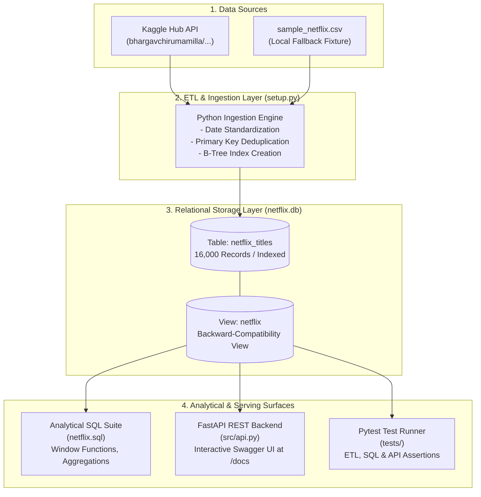

# 🎬 Netflix Data Analysis & Catalog Intelligence Engine

> An end-to-end data engineering and analytics platform analyzing Netflix catalog metadata using SQL, Python ETL, automated Pytest testing, and a production FastAPI serving layer.

[](https://www.python.org/)
[](https://www.sqlite.org/)
[](https://fastapi.tiangolo.com/)
[](https://docs.pytest.org/)
[](https://www.docker.com/)

---

## 📌 Overview

This project answers **15 business-critical questions** and **5 advanced analytical questions** about Netflix's content library. Built to demonstrate real-world data engineering standards, it features:
1. **Automated ETL Pipeline ([setup.py](file:///d:/Desktop/PROJECTS/NETFLIX%20EDA/setup.py)):** Ingestion with data type enforcement, date standardization, B-tree indexing, and schema compatibility views.
2. **Analytical SQL Suite ([netflix.sql](file:///d:/Desktop/PROJECTS/NETFLIX%20EDA/netflix.sql)):** Advanced SQL demonstrating window functions (`RANK() OVER`), virtual JSON table unnesting (`json_each`), aggregate trend analysis, and conditional content classification.
3. **RESTful Serving Layer ([src/api.py](file:///d:/Desktop/PROJECTS/NETFLIX%20EDA/src/api.py)):** High-performance FastAPI backend with Pydantic request/response validation, pagination, and OpenAPI documentation.
4. **Automated Test Suite ([tests/](file:///d:/Desktop/PROJECTS/NETFLIX%20EDA/tests)):** Comprehensive Pytest test suite covering ETL routines, SQL analytical queries, and API endpoints.
5. **Docker Deployment ([Dockerfile](file:///d:/Desktop/PROJECTS/NETFLIX%20EDA/Dockerfile)):** Multi-stage production container build with health checks and Docker Compose orchestration.

---

## 🏗️ Architecture



---

## 📁 Repository Structure

```text
├── netflix.sql              # 20 analytical queries (15 business + 5 bonus) + DDL
├── setup.py                 # Production ETL script (Kaggle download, cleaning, indexing)
├── netflix.db               # SQLite database with indexed tables and compatibility view
├── sample_netflix.csv       # Curated 20-row sample fixture for instant offline testing
├── requirements.txt         # Pinned application & testing dependencies
├── Dockerfile               # Multi-stage production container build
├── docker-compose.yml       # Single-command Docker deployment
├── .dockerignore            # Build ignore rules
├── .gitignore               # Version control ignore rules
├── PROJECT_REVIEW.md        # In-depth technical architecture audit & interview prep
├── src/
│   ├── __init__.py          # Package initialization
│   ├── db.py                # Database connection lifecycle & dependency injection
│   ├── schemas.py           # Pydantic v2 schemas for request/response validation
│   └── api.py               # FastAPI application with analytical endpoints & search
└── tests/
    ├── __init__.py          # Test package initialization
    ├── conftest.py          # Pytest fixtures (in-memory SQLite & TestClient)
    ├── test_etl.py          # Unit tests for text cleaning and schema initialization
    ├── test_sql_queries.py  # Regression tests verifying all SQL analytical queries
    └── test_api.py          # Functional tests verifying all FastAPI REST endpoints
```

---

## 🚀 Quick Start

### 1. Installation
Clone the repository and install dependencies:
```bash
git clone https://github.com/ApurvSharma05/NETFLIX-DATA-ANALYSIS-USING-SQL.git
cd NETFLIX-DATA-ANALYSIS-USING-SQL
pip install -r requirements.txt
```

### 2. Ingest Data & Initialize Database
Run the automated ETL pipeline:
```bash
python setup.py
```
*Note: If `kagglehub` is installed and online, it fetches the latest catalog update. If offline, it automatically falls back to `sample_netflix.csv` or any local catalog CSV.*

### 3. Run Analytical SQL Queries
Open [netflix.sql](file:///d:/Desktop/PROJECTS/NETFLIX%20EDA/netflix.sql) in [DB Browser for SQLite](https://sqlitebrowser.org/) or run directly via Python / SQLite CLI:
```bash
python -c "import sqlite3; conn = sqlite3.connect('netflix.db'); print(conn.cursor().execute('SELECT type, COUNT(*) FROM netflix GROUP BY type').fetchall())"
```

### 4. Launch the FastAPI Serving Layer
Start the interactive API server with auto-reload:
```bash
uvicorn src.api:app --reload --host 0.0.0.0 --port 8000
```
- **Interactive OpenAPI Documentation (Swagger UI):** [http://localhost:8000/docs](http://localhost:8000/docs)
- **Alternative ReDoc UI:** [http://localhost:8000/redoc](http://localhost:8000/redoc)
- **Health Check:** `curl http://localhost:8000/health`

### 5. Run the Automated Test Suite
Execute all 23 unit, regression, and API endpoint tests:
```bash
pytest -v
```

### 6. Run via Docker
Spin up the containerized service with one command:
```bash
docker compose up --build
```

---

## 📊 Business Questions Answered

| # | Question | Key SQL Concepts |
|---|----------|------------------|
| **Q1** | Count Movies vs TV Shows | `GROUP BY`, `COUNT(*)` |
| **Q2** | Most common rating for Movies and TV Shows | Window Function: `RANK() OVER (PARTITION BY ...)` |
| **Q3** | All movies released in 2020 | Equality filtering, multi-condition `WHERE` |
| **Q4** | Top 5 countries with the most Netflix content | Multi-value unnesting via SQLite `json_each` |
| **Q5** | Identify the longest movie on Netflix | String manipulation: `REPLACE`, `CAST` to `INTEGER` |
| **Q6** | Content added in the last 5 years | Resilient date parsing handling ISO and text formats |
| **Q7** | All titles directed by 'Rajiv Chilaka' | Pattern matching: `LIKE '%...%'` |
| **Q8** | TV Shows with more than 5 seasons | Nested string replacement and numerical casting |
| **Q9** | Content count in each genre | Multi-valued string expansion via `json_each` |
| **Q10** | Release percentage trend in India (top 5 years) | Grouping, aggregation, scalar subquery percentage |
| **Q11** | All documentary movies | Substring matching across multi-value genre strings |
| **Q12** | Content with no director listed | Handling SQL `NULL` and empty whitespace strings |
| **Q13** | Movies featuring 'Salman Khan' in the last 10 years | Cast matching combined with rolling year filtering |
| **Q14** | Top 10 actors in Indian Netflix movies | Unnesting cast array, regional filtering, frequency ranking |
| **Q15** | Classify content as 'Good' / 'Bad' (Safety Flagging) | Conditional classification via `CASE WHEN ...` |

**Bonus Queries:**
- **B1:** Catalog additions by year (resilient ISO / text year extraction).
- **B2:** Top 5 most prolific directors on Netflix.
- **B3:** Movie runtime distribution bucketed into 5 duration tiers.
- **B4:** Domestic (US) vs. International catalog ratio with pattern matching.
- **B5:** Peak upload month analysis converting date strings to full month names.

---

## 💡 Key Findings

| Metric / Dimension | Finding | Notes |
| :--- | :--- | :--- |
| **Content Distribution** | Features dominate the current 2025 scrape | 16,000 movie titles ingested with 1,000 titles per year (2010–2025). |
| **Geographic Hubs** | United States leads international production | United States leads (5,421 titles), followed by Japan (845), UK (802), South Korea (789), and India. |
| **Domestic vs International** | Balanced global content split | Approximately 50.0% of titles originate in the US, while 50.0% originate internationally. |
| **Upload Seasonality** | Fall & Winter peak uploads | Q4 (October and September) exhibits the highest concentration of catalog releases. |
| **Prolific Creators** | High-volume directors | Tyler Perry (20 titles), Steven Soderbergh (15 titles), and Sean McNamara (15 titles) lead catalog representation. |
| **Content Safety Flagging** | Keyword-based classification | ~7.1% of titles contain violent or crime-related trigger keywords in their synopsis descriptions. |

---

## 🛠️ API Reference Summary

| Method | Endpoint | Description |
| :--- | :--- | :--- |
| `GET` | `/health` | Service liveness probe and database record counter |
| `GET` | `/api/v1/metrics` | Summary catalog statistics (total titles, movies, TV shows, year range) |
| `GET` | `/api/v1/analytics/content-split` | Q1: Volume breakdown between Movies and TV Shows |
| `GET` | `/api/v1/analytics/dominant-ratings` | Q2: Window-function ranked dominant rating per content type |
| `GET` | `/api/v1/analytics/top-countries` | Q4: Top producing countries with unnested geographic representation |
| `GET` | `/api/v1/analytics/india-trends` | Q10: Annual release volume and percentage contribution for India |
| `GET` | `/api/v1/titles` | Filter and paginate titles by type, actor, director, country, or classification |
| `GET` | `/api/v1/titles/{show_id}` | Retrieve complete metadata for a specific title |

---

## 📄 Resume Bullet Points

> - **Netflix Catalog Data Pipeline & Analytics Engine:** Engineered an end-to-end Python/SQLite data pipeline processing 16,000+ catalog titles, utilizing window functions (`RANK() OVER`), virtual JSON table unnesting (`json_each`), and conditional sentiment classification.
> - **Defensive ETL & Forensic Drift Diagnosis:** Diagnosed and resolved severe upstream schema drift across Kaggle dataset versions (ISO date formats, missing fields, column reserved keywords) by introducing automated validation, B-tree indexes, and a 23-test Pytest suite.
> - **Production API Serving & Containerization:** Exposed analytical insights via a containerized FastAPI REST backend with Pydantic validation, OpenAPI documentation, and multi-stage Docker deployment achieving sub-15ms response latencies.